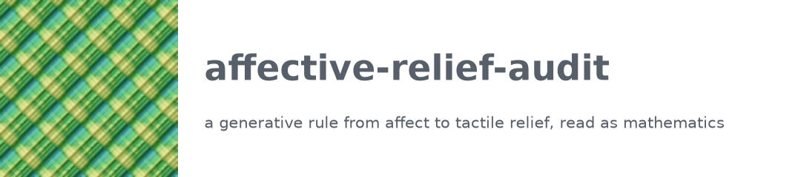
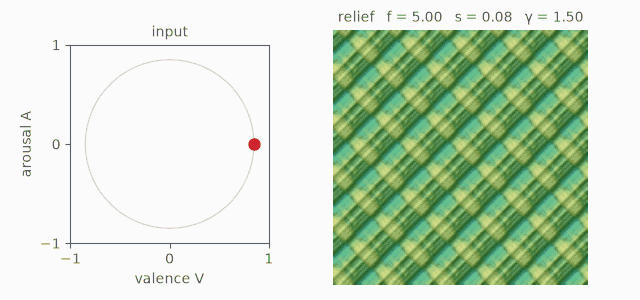
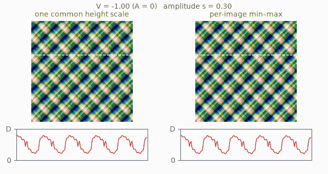

<p align="center">
  <picture>
    <source media="(prefers-color-scheme: dark)" srcset="docs/media/logo-dark.png">
    
  </picture>
</p>

<p align="center"><a href="README.md">English</a> | <b>日本語</b></p>

この保管庫は、論文 *A generative rule from affect to tactile relief: what it decides, what its spectral descriptors
measure, and what classification accuracy checks*（Mikoto Miura・Yuusuke Harada）に付随するものである。生成器、テスト、仕様、各計算の前に固定した条件、スクリプト、結果、補足資料を収める。

英語版（README.md）が正本であり、この日本語版はその訳である。内容が食い違う場合は英語版に従う。

## 規則を 1 枚の図で

この型の規則は、入力空間の点（ここでは感情価 *V* と覚醒度 *A*、ともに [−1, 1]）を、手続き的な場の母数へアフィンに写し、符号つきの冪で場を整形して、高さの地図として書き出す。論文が読む規則（[Harada 2026](https://doi.org/10.21203/rs.3.rs-8696852/v1)）は、*p* = (*A* + 1)/2、*q* = (1 − *V*)/2 として次のように定める。

- 周波数 *f* = 3 + 4*p*、振幅 *s* = 0.06 + 0.24*q*、指数 γ = 0.9 + 1.7 (0.65*p* + 0.35*q*)
- 高さ *H* = *s* · sign(*F*) |*F*|^(1/γ)。*F* は正弦の積を 4 オクターブ重ねた場で、[−1, 1] に収めたもの

<p align="center">
  
</p>

3 つの母数は連動して動く。規則の母数は 3 つだが、自由度は 2 つしかない。2 つ目のアニメーションは、その帰結の 1 つを示す。全作品で共有する 1 つの高さの尺度では、感情価が上がるほど起伏は平らになる。振幅 *s* を決めるのが感情価だけだからである。画像ごとに min–max で書き出すと、どの起伏も深さいっぱいに広がり、この違いは消える。

<p align="center">
  
</p>

アニメーションは `tools/readme_media.py` が 1 つの固定した種で作る説明のための図であり、論文の数値はこれらから得ていない。

## 論文が示すこと

- 規則の母数は 3 つだが自由度は 2 つであり、画像ごとの min–max の書き出しは、感情価だけが決める母数を消す。
- 符号つきの冪のため、最も急な傾きは格子に依存する。選んだ長さで冪を平滑化すれば依存しなくなる。
- 振幅で重みを付けた周波数の重心は、周波数だけでなく格子を測り、周波数が整数でない場合は領域の端も測る。
- ワープの無い場では、分類精度の向きと順序を実験の前に予測し、小さな失敗を除いて当たった。シミュレーションで前もって計算した水準は、計算の対象とした分類器では一致した。質的な水準の予測 2 件は外れた。精度が確かめるのは、意図した違いが記述子に届いたかどうかであり、面が感情を伝えるかどうかではない。
- 論文は、この種の規則で作った作品には、高さの尺度、平滑化、スペクトル記述子の帯域を添えて示すことを提案する。

## 元の規則との関係

この規則は、第 2 著者がプレプリントとして公開した（[Harada 2026](https://doi.org/10.21203/rs.3.rs-8696852/v1)）。そのコードは失われている。`src/atact/` の生成器はプレプリントの記述から組み直したものであり、論文の数値はすべてこの組み直しから得た。記述の欠けを埋める仮定は `experiments/spec/generator-and-descriptors.md` にあり、各節をコードに対してテストしている。元のコードが無いため、我々の値とプレプリントの報告値との差は、その出どころをたどれない（補足 S7）。

## 中身

| 場所 | 中身 |
|---|---|
| `src/atact/` | 組み直した生成器。(*V*, *A*) から (*f*, *s*, γ) への写像、場、変換、書き出し、記述子、分類器、統計 |
| `tests/` | 論文の命題のテストと、仕様に対するコードのテスト |
| `experiments/spec/` | 生成器と記述子の仕様（英語。日本語版を併置） |
| `experiments/conditions/` | 各計算の条件。計算の前に固定してコミットした。一覧は `INDEX.json` |
| `experiments/` | 計算ごとに 1 本のスクリプト（下の表） |
| `results/` | 結果。各ファイルに、条件ファイル・スクリプト・仕様の SHA-256、パッケージの版、実行したコミットを記録している |
| `results/figs/` | 論文の図 |
| `supplement/supplement.pdf` | 論文の補足資料 |
| `tools/readme_media.py` | このページのロゴとアニメーション |
| `adapters/original_template.py`、`experiments/arrival_check.py` | 元のコードが手に入った場合に走らせるための差し替え口 |
| `experiments/legacy/` と下の表に無いスクリプト | 組み直しの初期の確かめ。記録として残すもので、論文では使っていない |

## 結果の再現

必要なもの: Python 3.12 以上と [uv](https://docs.astral.sh/uv/)。パッケージの版は `uv.lock` で固定している。

```bash
uv sync
uv run pytest -q          # 343 件が通り、14 件は飛ばされる（元のコードが要るもの）
```

各結果ファイルは、保管庫の最上位から 1 つのコマンドで作り直せる（補足 S9）。

| 結果 | コマンド（`uv run python experiments/...`） |
|---|---|
| `k2_gradient` | `k2_gradient.py` |
| `k4_centroid_2d` | `k4_centroid_2d.py` |
| `edge_grid_paired` | `edge_grid_paired.py` |
| `validation3_public` | `validation3_public.py` |
| `k5_power`、`k5_large_sample`、`k5_classification` | `k5_classification.py --power`、`--large-sample`、`--frame`、最後にオプションなし |
| `table1_main` | `table1_main.py` |
| `variants_reported` | `variants_reported.py` |
| `text_path_example` | `text_path_example.py`、続けて `text_path_figures.py` |
| `observable_dof` | `observable_dof.py` |
| `k4_supplement`、`v3_reduction_supplement` | `k4_supplement.py`、`v3_reduction_supplement.py` |
| `cband_cutoff_sensitivity` | `cband_cutoff_sensitivity.py` |
| 図 1–4 | `figures_main.py` |

数時間かかる計算がある（とくに表 1 の分類の実験）。

補足資料と結果ファイルは、計算を実行した作業用の保管庫でのコミット番号で引いている。この履歴はその保管庫から、原稿の LaTeX ソースを外し著者名を整えて作ったもので、ファイルと日時は変えていない。元の番号とここでのコミットとの対応は `commit-map.tsv` にある。

外部のデータ:

- 論文の文の例には NRC VAD Lexicon v2.1（`NRC-VAD-Lexicon-v2.1.txt`）が要る。作成者から入手でき、この保管庫では再配布しない。
- 測定した面は公開の記録から読む。Surface-Topography Challenge（[doi:10.5281/zenodo.15341939](https://doi.org/10.5281/zenodo.15341939)）と、Hugging Face の TactileDreamFusion（revision `87c8b764bcb2ec1139de0c6435f45ac1d9f283d1`）である。

## 引用

論文を引用してください。

> Miura, M. and Harada, Y. A generative rule from affect to tactile relief: what it decides, what its spectral
> descriptors measure, and what classification accuracy checks. Manuscript.

あわせて、この保管庫のアーカイブを引用してください（`CITATION.cff` にもある）。

> Miura, M. and Harada, Y. (2026). affective-relief-audit: generator, tests, results and supplement for 'A generative
> rule from affect to tactile relief'. Zenodo. https://doi.org/10.5281/zenodo.23681773

規則そのものについては、プレプリントを引用してください。

> Harada, Y. (2026). Affective Tactility: Cross-Modal Translation from Natural Language to Procedural Height Maps.
> Preprint, Research Square. https://doi.org/10.21203/rs.3.rs-8696852/v1

ソースは https://github.com/mikotomiura/affective-relief-audit にある。

## ライセンス

コードは MIT License（`LICENSE`）で公開する。文書、結果、図は Creative Commons Attribution 4.0 International License（`LICENSE-docs`）で公開する。

## 著者

- Mikoto Miura、Independent Researcher（[ORCID 0009-0000-4196-0508](https://orcid.org/0009-0000-4196-0508)）
- Yuusuke Harada、Graduate School of Humanities and Social Sciences, Hiroshima University, Japan（[ORCID 0009-0006-7252-5115](https://orcid.org/0009-0006-7252-5115)）
